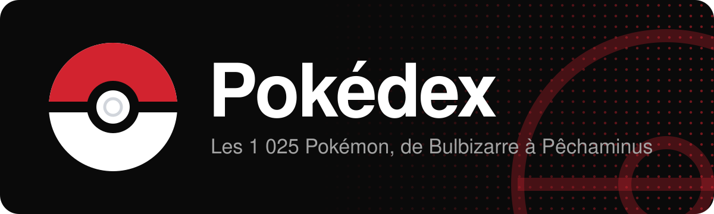

<p align="center">
  
</p>

<p align="center">
  <a href="https://nextjs-pokedex-sepia.vercel.app"><strong>Voir le site en ligne</strong></a>
  ·
  <a href="https://github.com/XiTawS/nextjs-pokedex/actions/workflows/ci.yml"></a>
</p>

Un Pokédex des 1 025 Pokémon, en français, construit avec Next.js 16 à partir des données de la [PokéAPI](https://pokeapi.co). Projet réalisé en suivant le cours « Next.js Pokédex », rangé dans [`knowledge/cours-nextjs-pokedex`](knowledge/cours-nextjs-pokedex/README.md).

## Fonctionnalités

- **Grille des 1 025 Pokémon** : recherche par nom (français ou anglais, sans tenir compte des accents), filtre par type et pagination, le tout gardé dans l'adresse (`/?q=pika&type=electric&page=2`).
- **Fiche de chaque Pokémon** : sprite animé de Showdown, types, description, poids, taille, talent, répartition des genres, statistiques, niveau et chaîne d'évolution, flèches vers le précédent et le suivant.
- **Favoris et sacoche** : six Pokémon avec surnoms et types couverts, enregistrés dans le navigateur.
- **Au hasard** : un bouton qui ouvre une fiche tirée au sort.
- **Soins du détail** : Poké Ball qui se remplit au lancement, squelettes de chargement, barre d'onglets sur téléphone, thème sombre, raccourci `/` vers la recherche, pages d'erreur et 404. Un œuf de Pâques est caché quelque part.

## Démarrer

Il faut Node.js 20.9 ou plus récent.

```bash
make install   # dépendances + hooks Git du projet
make dev       # http://localhost:3000
```

| Commande | Effet |
| --- | --- |
| `make dev` | Serveur de développement |
| `make lint` | Vérification ESLint |
| `make build` | Version de production |
| `make start` | Construit puis sert la version de production |
| `make check` | Lint et build, comme la CI |
| `make clean` | Supprime le cache de build |

`make` seul affiche cette liste. Les scripts `npm run …` équivalents restent disponibles.

## Technique

| Outil | Rôle |
| --- | --- |
| [Next.js 16](https://nextjs.org) | App Router, Cache Components (`"use cache"`), 151 fiches pré-générées |
| [React 19](https://react.dev) | Composants serveur et client, Suspense |
| [Tailwind CSS 4](https://tailwindcss.com) | Styles |
| [Astryx](https://astryx.atmeta.com) | Thème et notifications |
| [Zustand](https://zustand.docs.pmnd.rs) | Favoris et sacoche, persistés dans le navigateur |
| [Motion](https://motion.dev), [NumberFlow](https://number-flow.barvian.me) | Animations des barres et des nombres |
| [PokéAPI](https://pokeapi.co) | Données (REST et GraphQL pour les noms et textes en français) |

## Organisation

| Dossier | Contenu |
| --- | --- |
| `app/` | Pages, layouts, états (`loading`, `error`, `not-found`) et routes d'API |
| `components/` | Composants d'interface ; ceux marqués `"use client"` sont interactifs |
| `lib/` | Accès à la PokéAPI (en cache côté serveur), conversion des données et types de Pokémon |
| `stores/` | Stores Zustand : favoris, sacoche, mode caché |
| `hooks/` | Hooks personnalisés |
| `types/` | Types TypeScript de l'API et de l'application |
| `data/` | Données d'exemple du banc d'essai `/dev/pire-cas` (développement seulement) |

## Contribuer

- `main` est protégée : chaque changement passe par une branche (`feat/…`, `fix/…`) et une pull request.
- Les messages de commit suivent le format conventionnel `type(portée): description` ; un hook Git le vérifie.
- La CI (« Checks ») lance le lint et le build sur chaque pull request ; elle doit être verte pour fusionner.
- Vercel déploie la production à chaque fusion dans `main` et un aperçu pour chaque pull request.

## Crédits

Données et images de la [PokéAPI](https://pokeapi.co) et de ses [sprites](https://github.com/PokeAPI/sprites), icônes de type de [duiker101/pokemon-type-svg-icons](https://github.com/duiker101/pokemon-type-svg-icons). Pokémon et leurs noms sont des marques de Nintendo, Game Freak et The Pokémon Company ; ce projet d'apprentissage n'y est pas affilié.
